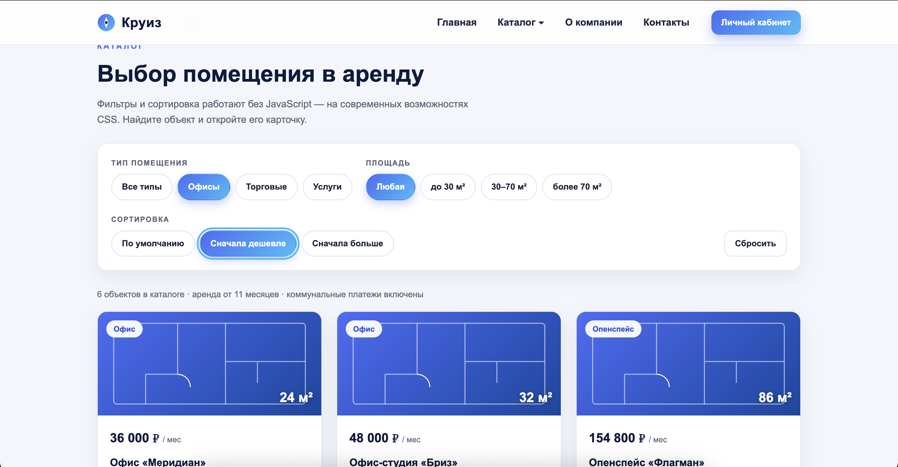
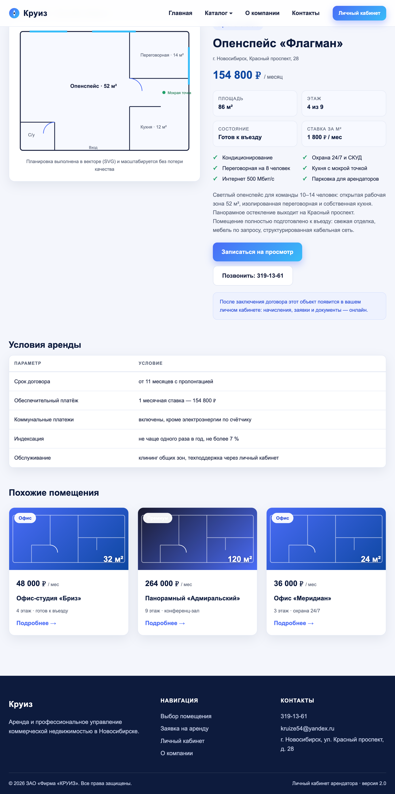
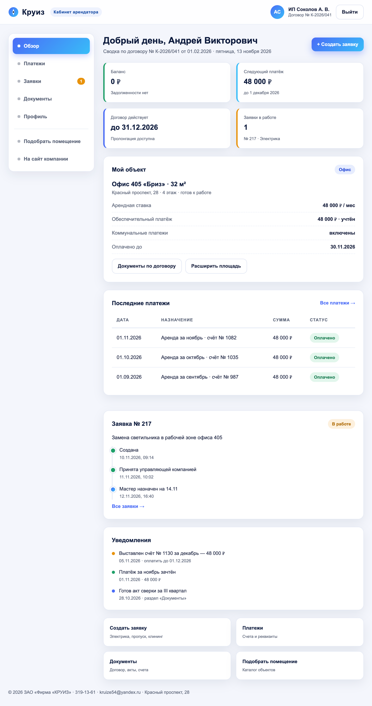
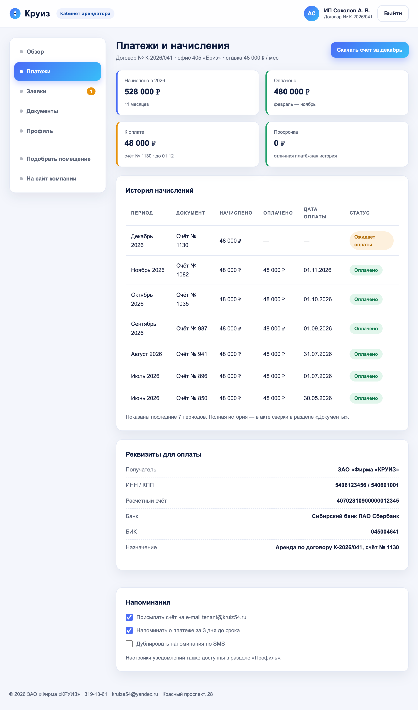

# Круиз — личный кабинет арендатора

Учебный прототип веб-приложения для компании «Круиз» (аренда и управление коммерческой недвижимостью, Новосибирск): публичный каталог помещений и личный кабинет арендатора. Проект выполнен в рамках учебной практики ПМ.08 «Разработка дизайна веб-приложений» (НГУЭУ, группа 9-ИС302).

## Особенности

- 10 страниц: 5 публичных (главная, каталог, карточка объекта, заявка, вход) и 5 кабинета (обзор, платежи, заявки, документы, профиль)
- Интерактив без JavaScript: фильтры и сортировка каталога на CSS-селекторе `:has()` и свойстве `order`, экраны подтверждения форм через `:target`, выпадающее и мобильное меню на чистом CSS
- Валидация форм средствами HTML5 (`required`, `type`, `pattern`, `minlength`)
- Векторная графика: SVG-планы помещений, логотип, фоновые паттерны — без растровых файлов
- Адаптивная вёрстка: контрольные точки 1100 / 900 / 560 px
- Единый корпоративный стиль: палитра #4a6cf7 / #0d47a1 / #38bdf8, шрифт Arial

## Запуск

Сервер и сборка не нужны:

1. Скачайте репозиторий (Code → Download ZIP) или клонируйте: `git clone https://github.com/NosikovNikita/kruiz-cabinet.git`
2. Откройте файл `html/index.html` в браузере.

Демо-вход в личный кабинет: `tenant@kruiz54.ru` / `kruiz2026` (проверка данных на сервере не выполняется — это прототип).

## Структура проекта

```
kruiz-cabinet/
├── html/            10 страниц приложения
├── css/             6 файлов стилей
├── screenshots/     скриншоты страниц
├── SlidePicture/ UI-кит, дашборд
└── README.md
```

## Скриншоты

Главная страница:


Каталог помещений:



Карточка объекта:



Личный кабинет, обзор:



Личный кабинет, платежи:



## Технологии

HTML5, CSS3 (Grid, Flexbox, custom properties, `:has()`, `:target`, media queries), SVG.

## Примечание

Проект является дизайн-прототипом: все данные демонстрационные и зашиты в разметку, формы не отправляют данные на сервер. Предназначен как основа для подключения серверной части.
